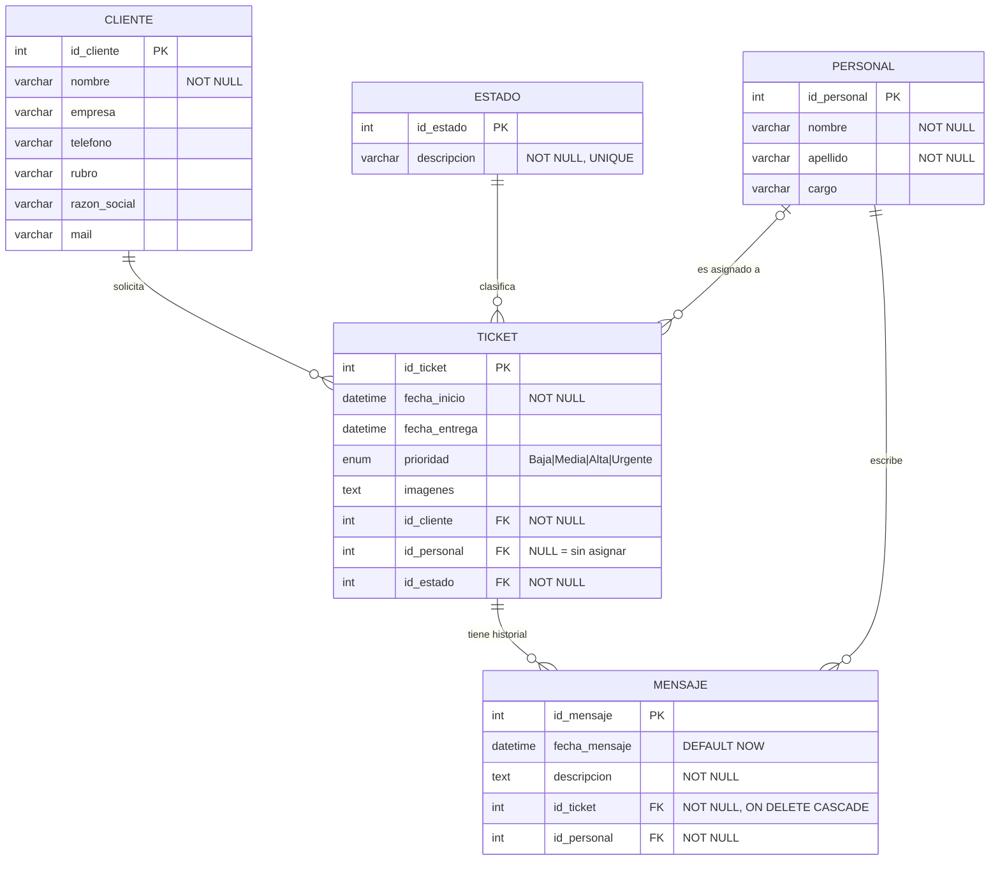

# Diagrama Entidad-Relación — `soporte_tickets`

Generado a partir de `database/Ticket.sql`. GitHub renderiza este bloque Mermaid automáticamente.

## Relaciones y cardinalidades

| Relación | Cardinalidad | Por qué (en el SQL) |
|---|---|---|
| cliente → ticket | 1 a 0..N | `ticket.id_cliente NOT NULL`: todo ticket tiene exactamente un cliente |
| estado → ticket | 1 a 0..N | `ticket.id_estado NOT NULL`: todo ticket está en un estado |
| personal → ticket | 0..1 a 0..N | `ticket.id_personal` admite NULL: un ticket puede no tener técnico |
| ticket → mensaje | 1 a 0..N | `ON DELETE CASCADE`: borrar un ticket borra sus mensajes |
| personal → mensaje | 1 a 0..N | `mensaje.id_personal NOT NULL`: todo mensaje tiene autor |
